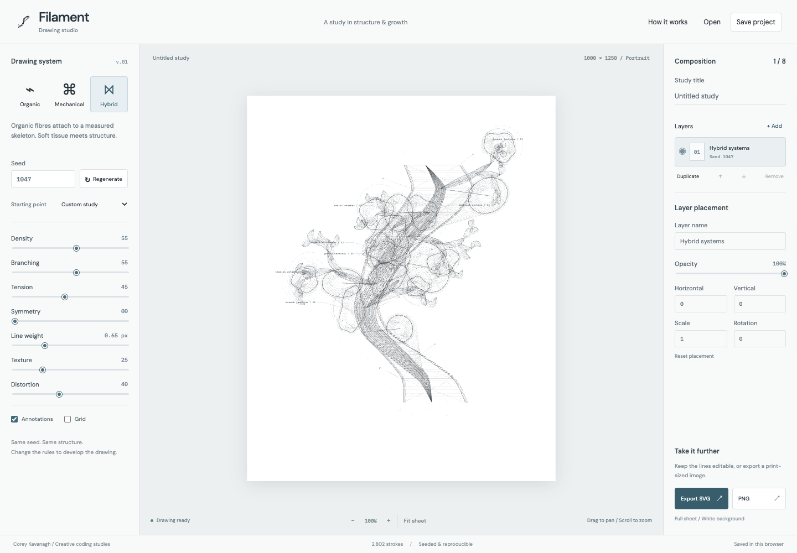

# Filament Studio

A local generative drawing instrument built with React, TypeScript, and Vite. Compose seeded organic, mechanical, and hybrid structures with a Canvas preview and editable SVG export.



## Download and use

Download `filament-studio-0.1.0-local.zip` from the [latest release](https://github.com/notlestat/filament-studio/releases/latest). Install [Node.js 22.12 or newer](https://nodejs.org/), unzip it, and open a terminal in the extracted folder.

```sh
npm start
```

Open the local address printed in the terminal, normally http://127.0.0.1:5180/. Keep the terminal open while drawing. The ZIP contains the built app and needs no dependency installation, build, account, or API key. See [local-use instructions](docs/LOCAL-USE.md) for details.

## Run from source

Choose **Code → Download ZIP** on GitHub, then unzip it. Alternatively, clone the repository:

```sh
git clone https://github.com/notlestat/filament-studio.git
cd filament-studio
```

Open a terminal in this folder, then run:

```sh
npm ci
npm run dev
```

Open the local address Vite prints, normally http://127.0.0.1:5173. Keep the terminal open while drawing. Editing source files updates this local browser copy. Nothing is published online by these commands. Use Node.js 22.12 or newer.

```sh
npm run build
npm run preview
npm run typecheck
npm test
```

The production build is in `dist/`. Any static host can serve it. GitHub Actions checks types, tests, and the production build on pull requests and pushes to `main`.

## Make a drawing

1. Choose Organic, Mechanical or Hybrid and a starting point.
2. Adjust the rules. Keep the seed to develop the same structure; Regenerate chooses a new seed.
3. Add layers to combine systems. Select a layer to change its rules, opacity, position, scale or rotation. Press Enter or leave a placement field to apply its value. Escape cancels the edit. The top layer in the list draws last. Hide, duplicate, reorder or remove layers.
4. Drag to pan, scroll to zoom, or use the view buttons. Keyboard: arrows pan, plus/minus zoom, zero fits the sheet.
5. Export SVG for vector editing in Illustrator or another editor. Export PNG for a 2400 × 3000 white-background image. Both export the entire 1000 × 1250 sheet, including visible layers and enabled annotations/grid. Zoom and pan do not change the export.
6. Save project downloads a JSON file with every seed and setting. Open loads it later. The latest project also saves automatically in this browser. Download a project before clearing browser storage.

## How the procedural system works

The references inform the drawing vocabulary: tapered fibres, empty chambers, radial ribs, attachment points, tension membranes and white space. The tool generates original rule-based studies; it does not trace or embed the reference images.

A deterministic pseudorandom generator makes each seed reproducible. Every mode starts with a curved spine. That spine keeps dense marks organised around a recognisable body.

- **Organic growth:** bounded recursive branches bifurcate and taper. Sampled curves become cubic Bezier splines. Parallel fibres spread around those curves, widening through their centres and closing at their ends. Deformed chambers receive radial hatching. Short streamlines curl around chamber anchors in a coherent flow field.
- **Mechanical framework:** paired rails follow the spine, linked by ribs and diagonal braces. Radial hubs attach to the spine with cables. Their geometry shares anchor points rather than behaving like unrelated noise.
- **Hybrid systems:** both procedures share a spine and coordinate space, linking fibres and construction geometry.

Density changes fibre and rib count. Branching changes recursive depth, bud count and framework attachments. Tension changes spline control-point reach. Symmetry adds a reflected counterpart with adjustable opacity. Line weight multiplies path thickness. Texture adds sparse local hatch marks. Distortion bends the spine, bundles and chamber contours. Texture is vector hatching, not a scanned-paper filter.

`src/engine.ts` contains the algorithms. `generator.worker.ts` runs them away from the UI thread, debounces input through the app and caches up to 24 generated structures. Branch recursion, eight composition layers and a limit of 4,800 strokes per layer before reflection bound the work. Extreme settings can reach this drawing budget. `CanvasView.tsx` caches Path2D geometry, handles pan/zoom and caps display pixel ratio at 2. `export.ts` builds SVG from the same paths and rasterises that SVG for PNG, preserving drawing geometry across formats.

## Scope of this initial version

The drawing sheet has a fixed portrait format. Layer placement is numeric; viewport dragging pans the sheet. There is no direct node editing, freehand drawing, animation, undo history or pinch gesture. Annotations are procedural labels, not scientific measurements. Dense compositions may take longer to generate or export. SVG path groups are organised by opacity and weight within each composition layer rather than exposing every stroke separately. A project file retains the settings, not hand-edited SVG changes.

The interface loads DM Sans and IBM Plex Mono from Google Fonts when available, with local system fallbacks. Drawing generation, project data and artwork remain in the browser. The fonts are the only external runtime resource.

## Project origin

The implementation was imported from the original local Filament Studio prototype. The [original conversation](https://chatgpt.com/s/cx_6add462392348191968d8d3dbaefe592) records the brief and initial build. The source folder remains intact. This repository includes validation and error-handling fixes made during the import. See [the review record](docs/REVIEW.md) for checks and remaining limits.

To build the local-use download from source, run `npm run package:local`. The ZIP is written to `release/`.
